# 🔧 FleetGuard
An end-to-end, uncertainty-aware predictive maintenance and fleet optimization system built on NASA's C-MAPSS turbofan degradation data.

FleetGuard predicts Remaining Useful Life (RUL), quantifies prediction uncertainty using a 300-tree ensemble, prioritizes machines by a defensible two-dimensional risk score, optimizes maintenance scheduling under technician-hour constraints via MILP, and explains model decisions with SHAP — all tied together by an interactive what-if dashboard.

📊 Pipeline Architecture
```                    
                      Raw C-MAPSS FD001 Data
                              |
                              v
    +---------------------+---------------------+---------------------+
    | 01. Data Prep       | 02. RUL Prediction  | 03. Uncertainty     |
    |---------------------|---------------------|---------------------|
    | - Load & validate   | - Feature engineering| - 300-tree ensemble|
    | - RUL labels        | - Ridge / RF / XGB  | - 90% & 80% CIs     |
    | - Engine-wise split | - NASA scoring      | - Calibration check|
    +---------------------+---------------------+---------------------+
                                                    |
                                                    v
    +---------------------+---------------------+---------------------+
    | 06. Explainability  | 04. Risk Assessment | 05. Optimization    |
    |---------------------|---------------------|---------------------|
    | - SHAP TreeExplainer| - RUL x Uncertainty | - MILP via HiGHS    |
    | - Global + local    | - 3x3 risk matrix   | - Greedy baselines  |
    | - Feature groups    | - Sensitivity check | - Post-hoc RUL eval |
    +---------------------+---------------------+---------------------+
                              |
                              v
                    +---------------------+
                    | 07. Dashboard       |
                    |---------------------|
                    | - Live prediction   |
                    | - What-if mode      |
                    | - RUL gauge         |
                    +---------------------+
```
---

## 🚀 Key Results

| Metric | Value | Context |
|---|---|---|
| **Best Model** | XGBoost | 500 trees, max_depth=4, lr=0.03 |
| **Validation MAE** | ~12.5 cycles | 20-engine held-out set |
| **Test MAE** | ~12.8 cycles | 100-engine official FD001 test set |
| **Test NASA Score** | ~536 | Asymmetric penalty (lower = better) |
| **Uncertainty Ensemble** | 300-tree Random Forest | Tree-level prediction distribution |
| **90% CI Coverage** | ~90% | Empirical match on validation set |
| **Uncertainty–Error Corr.** | Pearson r > 0.3 | Higher std → larger error (informative) |
| **Optimization** | MILP (HiGHS) | Exact 0-1 knapsack, ~42% budget utilization |
| **Optimality Gap vs Greedy** | >0% | MILP outperforms both greedy baselines |

---

## 📁 Repository Structure
```
FleetGuard/
├── CMAPSSData/                 # Additional C-MAPSS subsets
├── data/
│   ├── raw/                    # Original FD001 TXT files
│   └── processed/              # Cleaned CSV datasets
├── notebooks/
│   ├── 01_data_exploration.ipynb
│   ├── 02_rul_prediction.ipynb
│   ├── 03_uncertainty_estimation.ipynb
│   ├── 04_risk_assessment.ipynb
│   ├── 05_maintenance_optimization.ipynb
│   ├── 06_explainability.ipynb
│   └── 07_dashboard.ipynb
├── outputs/
│   ├── figures/                # Visualizations saved during run
│   ├── results/                # Quantitative CSV tables
│   └── models/                 # Serialized model pipelines
└── README.md
```

---

## 📓 Walkthrough & Key Visualizations

Each stage of the FleetGuard framework is fully visual and backed by empirical output tables found in `outputs/`.

### 01 — Data Exploration & Preparation
- **Target Engineering**: Constructs capped (`rul`) and uncapped target variables.
- **Leakage Prevention**: Engine-wise 80/20 train/validation splitting using `GroupShuffleSplit`.
- **Visualizations Included**:
  <p align="center">
    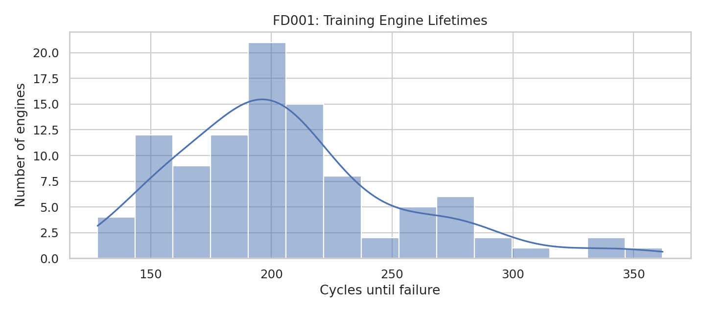
    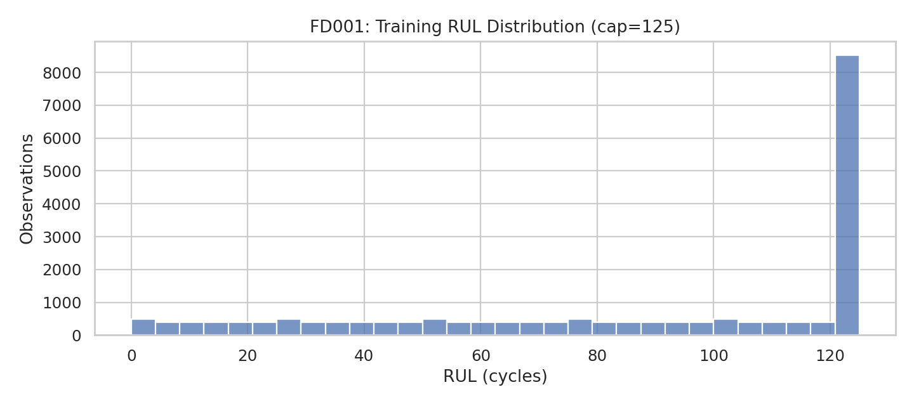
  </p>
  <p align="center">
    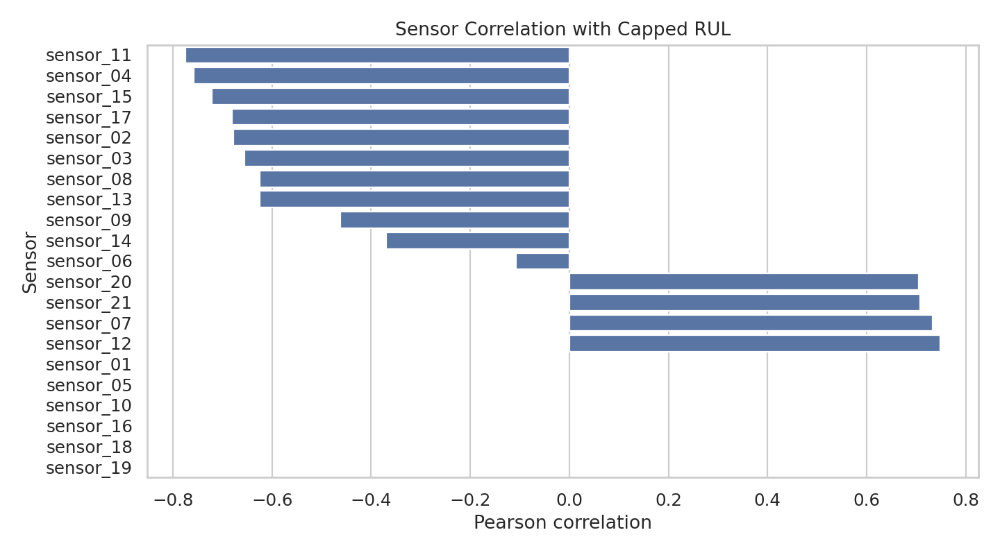
  </p>

### 02 — RUL Prediction
- **Feature Engineering**: Calculates rolling temporal statistics (means, standard deviations) across 15 active sensors to capture degradation slope.
- **Algorithms**: Evaluated Ridge, Random Forest, and XGBoost using asymmetric loss.
- **Visualizations Included**:
  <p align="center">
    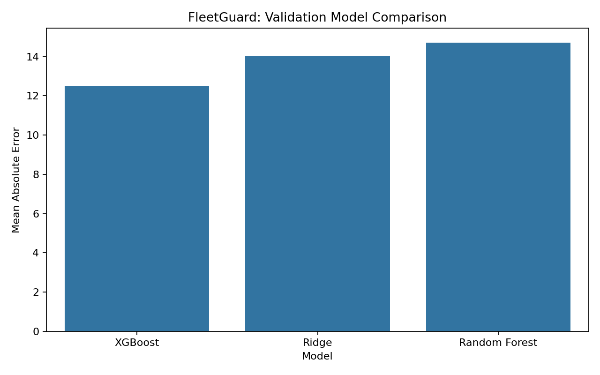
  </p>

### 03 — Uncertainty Estimation
- **Quantifying Epistemic Variance**: Extracting individual tree predictions from a 300-tree Random Forest to construct prediction confidence bounds.
- **Calibration Analysis**: Validates interval coverage against actual test errors.
- **Visualizations Included**:
  <p align="center">
    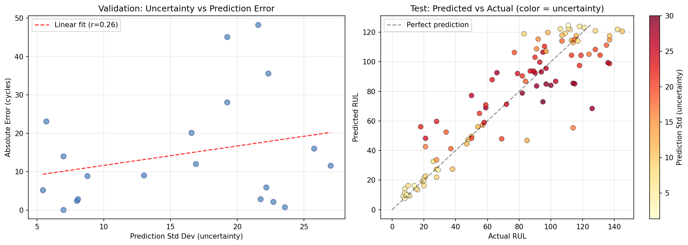
  </p>

### 04 — Two-Dimensional Risk Assessment
- **Formulation**: Compiles individual Risk Priority Scores: $RPS = 0.70 \times Rank(1/RUL) + 0.30 \times Rank(\sigma)$.
- **Risk Categorization**: Dynamically segments engines into high, medium, and watch actions based on uncertainty-aware critical thresholds.
- **Visualizations Included**:
  <p align="center">
    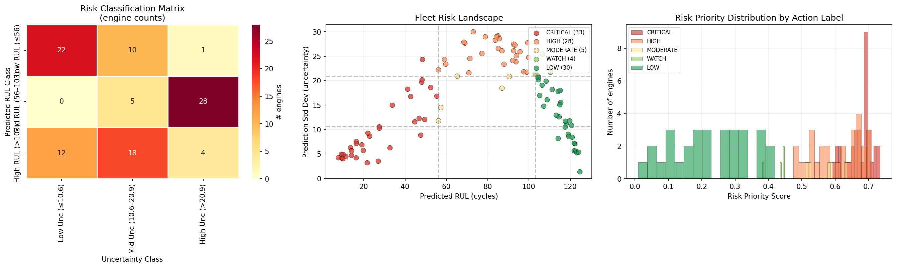
    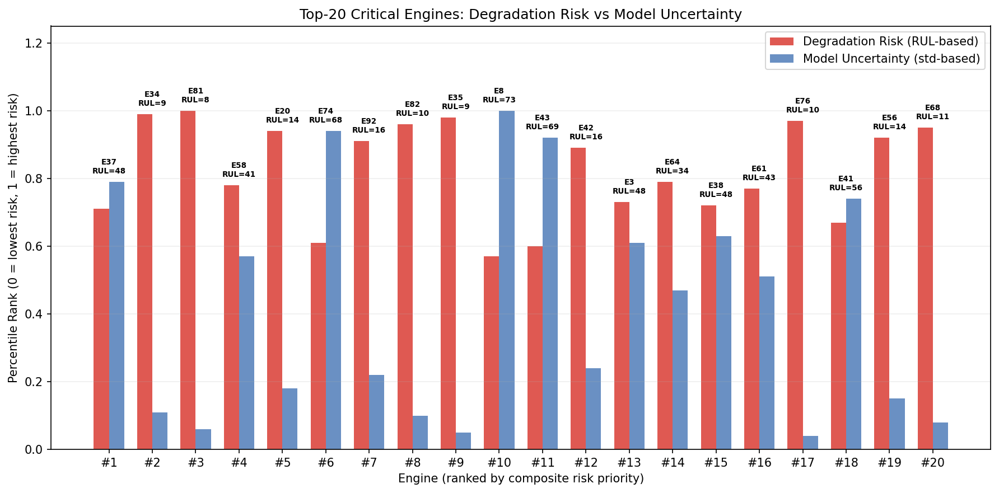
  </p>

### 05 — Maintenance Optimization (MILP)
- **Operational Problem**: Exact binary Knapsack formulation using High Performance Parallel Solver (`HiGHS`) to solve the resource allocation bottleneck.
- **Comparison**: Evaluates optimization yield against risk-greedy and cost-greedy operational heuristics.
- **Visualizations Included**:
  <p align="center">
    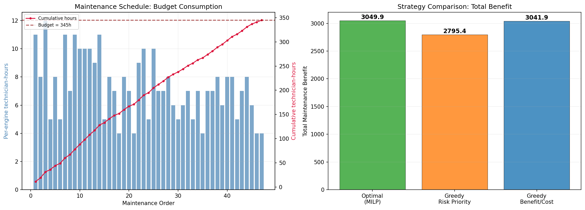
    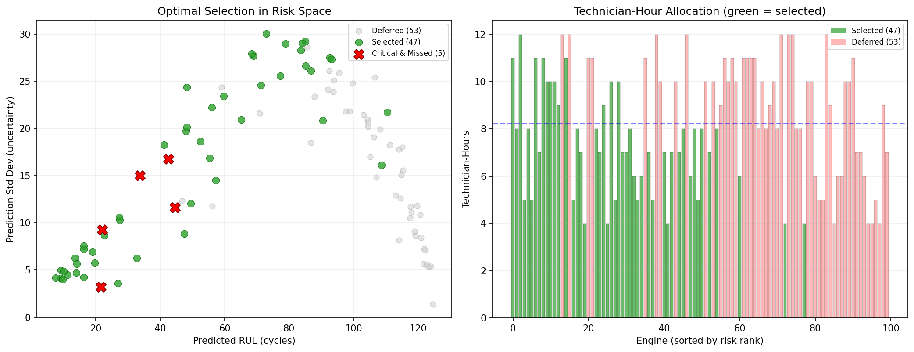
  </p>

### 06 — Global & Local Explainability
- **Post-Hoc Attribution**: Uses SHAP TreeExplainer to break down both global features and point-level test cases (explaining individual anomalous cycles on a degraded engine).
- **Visualizations Included**:
  <p align="center">
    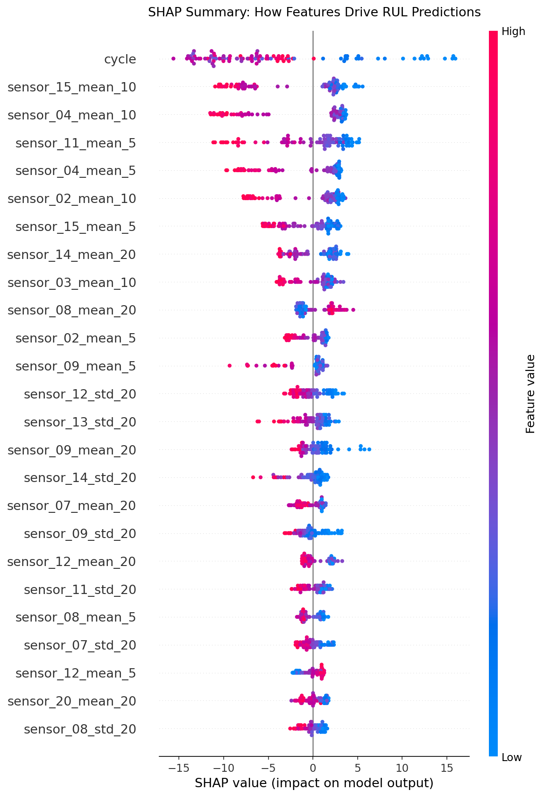
    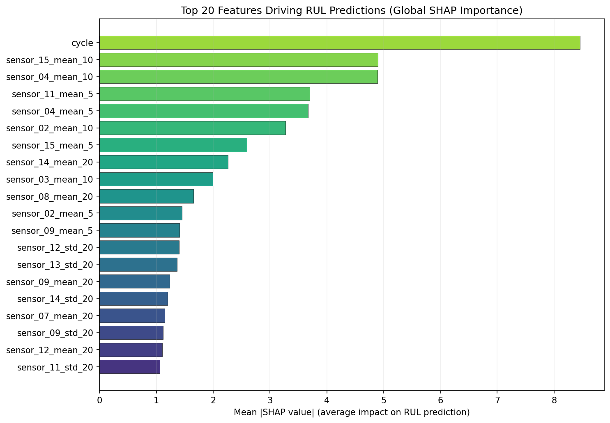
  </p>
  <p align="center">
    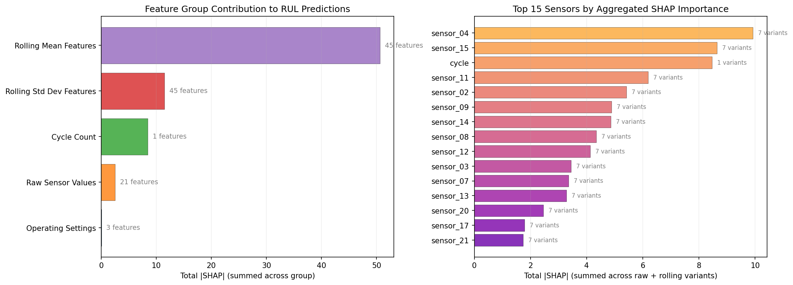
    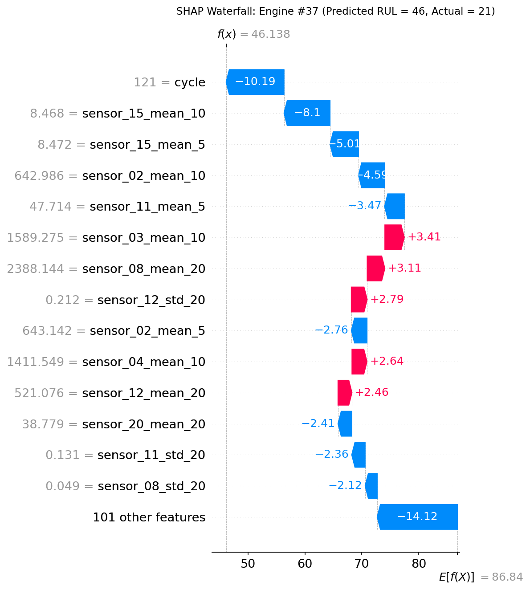
  </p>
